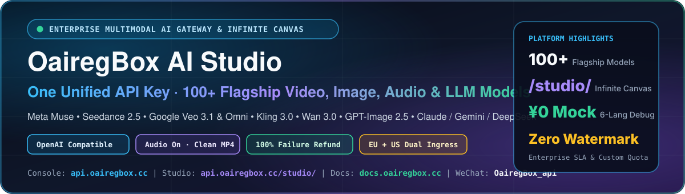

  

  
  
  
  
  

## ⚡ About OairegBox AI Studio

**OairegBox** 是面向 AI 短剧/漫剧工作室、多模态应用团队与 Agent 打造的一站式 **全模态 AI API 聚合网关与无限画布创作平台**。只需一个标准 OpenAI 兼容密钥（`sk-...`），即可无缝调度全球 100+ 款顶尖视频生成、原生高分生图、全双工语音及旗舰推理大模型。

- **🌐 双地域高速接入（同账号 · 同令牌 · 同余额互通）**：
  - **主线路（欧洲）**：[`https://api.oairegbox.cc`](https://api.oairegbox.cc)
  - **备用加速线路（美东）**：[`https://newapi.oairegbox.cc`](https://newapi.oairegbox.cc)
- **🎨 无限画布多模态工作台（Infinite Canvas）**：[`https://api.oairegbox.cc/studio/`](https://api.oairegbox.cc/studio/) — 支持剧本拆解、2K 角色三视图、16 套电影学导演运镜预设、多参考图连线与 60s 长视频续写一站式可视化编排。
- **🧪 交互式 API 调试台（¥0 模拟测试 + 6 语言代码实时生成）**：[`https://docs.oairegbox.cc`](https://docs.oairegbox.cc) — 内置 **¥0 免费契约联调模式** 与真实调用模式，一键生成 `cURL / Python / Go / Node.js / Java / PHP` 生产级代码。
- **🛡️ 干净成品与计费透明承诺**：生视频/生图默认 **原生带音轨、无平台水印直出**；异步任务失败 **100% 自动全额退回预扣额度**，每一笔任务 ID 与计费明细后台实时可追溯。

---

## 🎬 旗舰多模态模型矩阵（部分精选）

| 模态领域 | 核心上线模型系 | 亮点能力 |
| :--- | :--- | :--- |
| **🎥 AI 视频与漫剧导演** | **Meta Muse (`muse-video-10s~60s`, `muse-director`)** **ByteDance Seedance 2.0 / 2.5** **Google Flow Veo 3.1 / Omni 1.1 Flash** **快手可灵 Kling 3.0 (`kling-v3`)** **阿里云通义万相 `wan3.0-video`** **xAI `grok-imagine-video`** | • 支持文生视频、首尾帧、多参考图角色锁脸与 `video_url` 无缝续写 • `muse-director` 支持剧本自动拆镜与粘性沙盒接续 • 默认有声直出、无水印，失败 100% 自动退费 |
| **🖼️ 原生高分生图与编辑** | **OpenAI `gpt-image-2` / `gpt-image-2.5` (2K/4K 同步&异步)** **ByteDance `seedream-5.0-pro` (组图 & 多图参考)** **Google `gemini-3-pro-image`** **Alibaba `qwen-image-3.0-pro`** **Meta `muse-image` (原生 2K WebP ¥0.03/张)** **xAI `grok-imagine-image-2.0`** | • 原生 2K / 真 4K 超清直出与局部/多图融合编辑 • 角色服装/五官高一致性设定图生成 |
| **🎙️ 播客 · 语音 · 音乐** | **Meta `muse-podcast` / `muse-tts` / `muse-asr` / `muse-live`** **Google Gemini Native TTS & Music** | • 双人多音色深度播客 MP3 一键生成 • 超拟真情感配音、高精度转写与实时语音交互 |
| **🧠 旗舰推理与 Agent LLM** | **Claude 全系列 · Gemini 4 Argon (`gemini-fast` / `gemini-vertex` / `gemini-anti-ultra`) · OpenAI GPT 全系列 · DeepSeek 思考模型 · Meta `muse-chat` / `muse-agent`** | • 完整兼容 `/v1/chat/completions`、`/v1/messages` 与 `/v1beta/...:generateContent` 原生双端点 • 适配 Claude Code、Codex、Cursor、OpenClaw 等各类编码与创作 Agent |

---

## 📦 精选开源项目（Open-Source Ecosystem）

- 👉 **[`muse-skills-handbook`](https://github.com/abigail-anderson51/muse-skills-handbook)** — **Meta Muse 全系 16 款模型中转操作手册、粘性会话自动接续指南、无限画布（`/studio/`）工作流与 16 套电影学 AI 导演预设 Skills 套件（MIT 开源）**
  - 内含 3 个开箱即用的标准 `SKILL.md`（`muse-relay-api`、`muse-director-shotcraft`、`muse-infinite-canvas`）
  - 完整导出 7 套视觉画风 + 16 套导演运镜预设 + 5 套黄金组合 + 全球 24 大开源 AI 导演仓库图鉴（`director_presets_catalog.json`）

---

## 🤝 商务合作与技术支持

- **控制台注册与自助取 Key**：[https://api.oairegbox.cc](https://api.oairegbox.cc)
- **在线开发文档与价格目录**：[https://docs.oairegbox.cc](https://docs.oairegbox.cc)
- **管理员 / 企业客服微信**：**`OairegBox_api`**（添加备注 `GitHub`，支持技术对接排障、短剧团队高并发专线与大额充值折扣）
